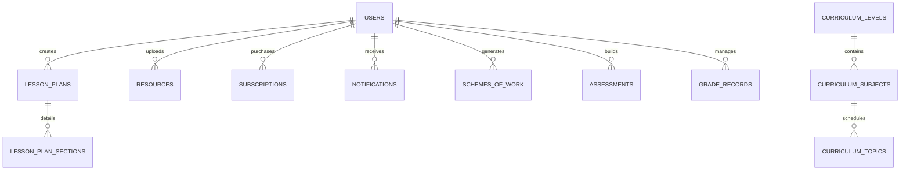

# Relational Data Model & ERD — EduPlan NG

---

## 1. Entity Relationship Diagram (Mermaid)

---

## 2. Table Specifications

- **`users`**: Teacher identities, credentials, assigned classes, school, and onboarding timestamps.
- **`curriculum_levels`**: 6 secondary classes (JSS 1, JSS 2, JSS 3, SSS 1, SSS 2, SSS 3).
- **`curriculum_subjects`**: Core subjects across junior and senior cycles.
- **`curriculum_topics`**: 936 weekly syllabus topics with Bloom objectives, activities, materials, and evaluation.
- **`lesson_plans`**: Teacher plans with 20s autosave, differentiated matrices, and Bloom tags.
- **`subscriptions`**: Kora Pay transaction references, active tiers (Monthly, Annual, School), and expiry.
- **`assessments`**: Multiple-choice and essay exams with official school letterheads and marking schemes.
- **`grade_records`**: Continuous assessment scores (CA 1, CA 2, Exam) and WAEC A1–F9 broadsheet grades.
